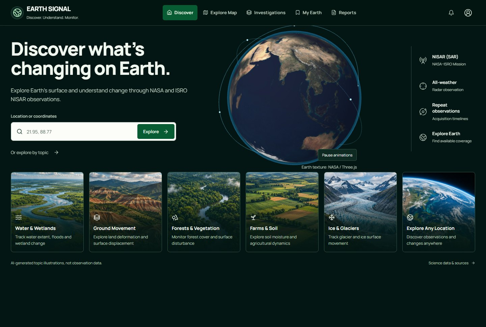
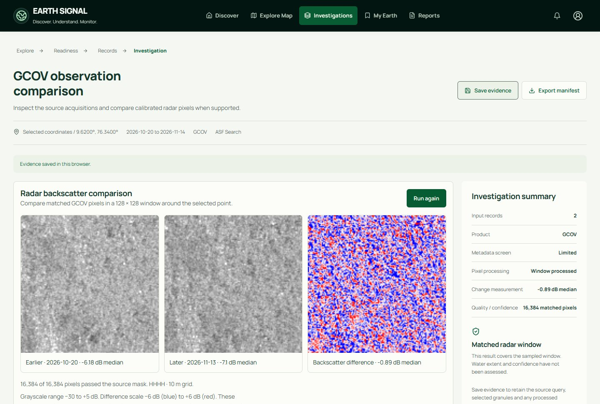
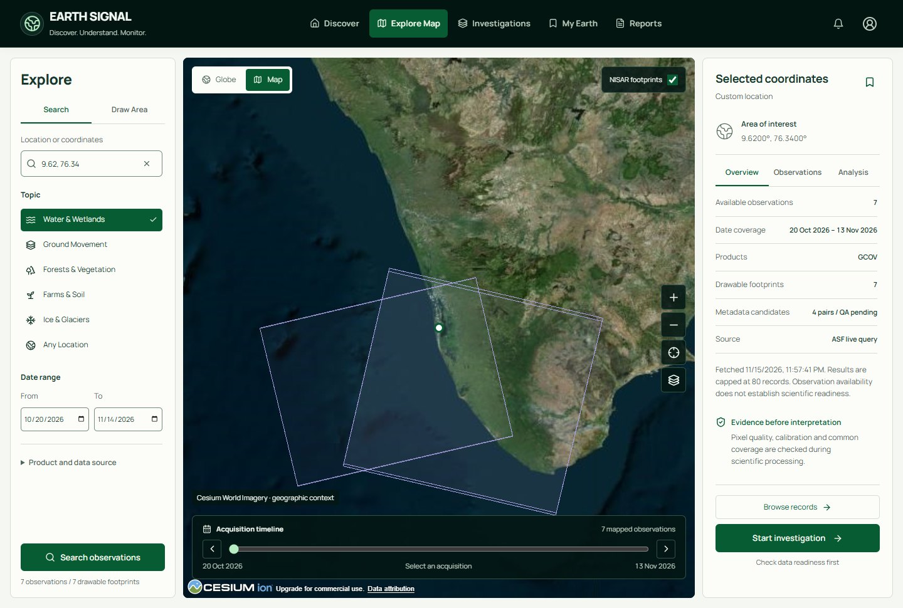
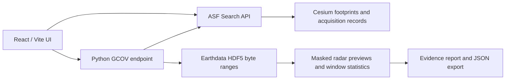

# Earth Signal

Search NASA–ISRO NISAR observations, inspect their acquisition footprints, and compute a traceable radar backscatter comparison from the original measurement files.

[Open Earth Signal](https://earth-signal-seven.vercel.app/) · [Try the Kerala GCOV comparison](https://earth-signal-seven.vercel.app/investigate/selected?lat=9.62&lon=76.34&product=GCOV&start=2026-10-20&end=2026-11-14&a=NISAR_L2_PR_GCOV_033_113_A_006_4005_DHDH_A_20261020T003206_20261020T003233_P05023_N_F_J_001&b=NISAR_L2_UR_GCOV_035_113_A_006_4005_DHDH_A_20261113T003207_20261113T003234_P05036_F_F_J_001)



## Try a real comparison

1. Open the Kerala comparison above and choose **Process comparison**.
2. Review the earlier, later and difference images. The reference run at 9.62° N, 76.34° E compared 16,384 valid HHHH pixels and returned a median difference of −0.89 dB.
3. Choose **Export radar result** to download the rendered window and its provenance. **Save evidence** adds the source records and processing summary to Reports on this browser.



The processor reads a 128 × 128 window from each GCOV HDF5 file. It requires matching acquisition geometry, channel, projection and pixel grid, then masks invalid samples and converts gamma-nought power to decibels using `10 × log10(power)`. It reports later minus earlier backscatter for the common valid pixels. Water extent, flooding, and confidence require separate validation. [ASF GCOV product guide](https://nisar-docs.asf.alaska.edu/gcov/)

## Explore and inspect records

Search a suggested place or decimal coordinates, or draw a rectangle in Explore. Filter by UTC day, product, orbit direction and relative track. Readiness and Records offer suitable source selections for running a window analysis. Export the valid pixel values with their projected coordinates or save a report with the query, results, quality checks and source provenance. [Research workflow and supported measurements](docs/RESEARCH_WORKFLOW.md)



## Data flow



Vercel serves the frontend and API routes. The Python endpoint resolves exact ASF granule IDs and requests only the byte ranges it needs. The Earthdata credential stays server-side. Supabase is optional for syncing saved places. Catalog footprints, official browse previews and processed radar windows are labeled separately in the app.

## Run locally

Install Node.js 22 or later and Python 3.11–3.13.

```bash
npm ci
python -m pip install -r requirements.txt
npm run dev
```

Create `.env.local` from [the environment template](.env.example) and set `EARTHDATA_TOKEN` for radar processing. If the Python interpreter is outside your PATH, set `EARTH_SIGNAL_PYTHON` to its executable path. Public catalog search works without an Earthdata token.

```bash
npm run verify
npm run test:ui
node tests/gcov-live.mjs http://localhost:5173
```

The live test calls ASF with the two published Kerala acquisitions and checks the grid, valid-pixel count, rendered PNGs and reference median difference.

See [the project brief and architecture](docs/earth-signal-kit/README.md) and [source attribution](NOTICE.md).
