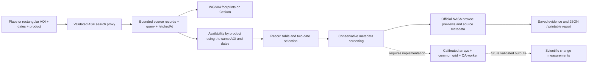

# Earth Signal evidence workflow

This implementation connects live metadata discovery to a source-record investigation. It does not claim that a calibrated scientific processing worker exists.

The globe uses one camera owner. Map mode uses a local overhead view; Globe mode frames the whole Earth at the requested coordinates. All geographic positions use Cesium's WGS84 ellipsoid, with no terrain exaggeration. Natural Earth is a local fallback; satellite layers load above it and retain provider attribution. The Home Earth is contextual imagery with a 23.44° display axial tilt, not a spacecraft tracking instrument.

`workflow.js` carries the point or rectangle, dates, product and source mode between routes. Readiness preserves polygon bounds rather than substituting its center. A bounded dataset envelope retains original source fields, query, timestamp and search cap. Session storage supports navigation without a second query; URL filters permit reconstruction when that envelope is unavailable. Reconstruction refetches the archive and can return a newer result; it is not an immutable cloud archive. Saved evidence keeps the selected records themselves in this browser, up to ten investigations.

The ASF proxy coalesces identical in-flight requests, caches at most twelve successful queries for five minutes, and retains their original fetch timestamps. It makes at most two upstream attempts, with ten-second timeouts per attempt. Failures do not become demonstration data. Neither upstream availability nor a successful metadata query guarantees protected browse access.

Pair screening requires two distinct dates, valid geometry and matching known product, track, frame, orbit direction, sensor, polarization, source configuration and processing version. Missing values never default to a shared track or direction. The result is labelled **metadata candidate**, not scientifically compatible. Common valid coverage, grid registration, calibrated channels and quality masks remain unverified. Measurements, confidence and change overlays are withheld.

Records, investigation and report routes are usable without fabricated science. Official browse images use the bounded server-side Earthdata proxy; they have loading, unavailable and ready states. Their display pixel values are never treated as calibrated backscatter. Source metadata and manifests remain accessible when imagery fails. My Earth performs manual GCOV checks on saved locations; background alerts are not enabled. Browser evidence saves do not imply cloud synchronization of source records.

References checked: [Team Zenith repository](https://github.com/nabil24024004/Team-Zenith-Dancing-With-SARs), [Zenith workflow plan](https://github.com/nabil24024004/Team-Zenith-Dancing-With-SARs/blob/main/TEAM_ZENITH_PROJECT_PLAN.md), and [ASF search API contract](https://docs.asf.alaska.edu/api/keywords/). Zenith's discovery, track/frame grouping and source inspection inform the workflow. Browse luminance is not promoted into scientific measurements.

Verify from the repository with `rtk npm run verify` and `rtk npm run test:ui`. Workflow unit tests cover AOI/date/product round-tripping, missing metadata, mixed products, same-date rejection, invalid geometry, duplicate records and export truth gates. Browser workflow tests use explicit fixtures for deterministic integration; separate live journeys exercise ASF and preserve actual source provenance. Local previews: http://127.0.0.1:5173/ and http://127.0.0.1:5173/explore .

Remaining infrastructure: a calibrated science worker with documented product variables, geocoding/resampling, QA and masks; durable artifact/job storage; authenticated scheduled monitoring; and measured operational performance. Earthdata credentials remain server-side. A production build's large-bundle warning remains a performance follow-up.
