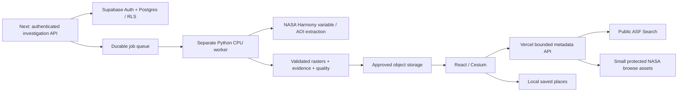

# Earth Signal live architecture and setup

## Implemented in this sprint

- React/Vite on Vercel serves the application.
- Explore defaults to live public ASF NISAR discovery through `/api/asf-search`. Coordinates, dates and science product are submitted explicitly. Bundled metadata remains a separate, manually selected source.
- The discovery API validates dates, coordinates, products and result limits; bounds upstream requests to 20 seconds; reports errors without silently substituting snapshots; returns provenance and fetch time. It performs no database writes and sends no NASA credentials for public search.
- `/api/earthdata-asset` only accepts allowlisted NASA hosts and small image/metadata types. Responses are capped at 3 MiB with a 15-second timeout. It rejects HDF5 downloads and redirects. Some NASA assets need a full authenticated redirect workflow; that is not implemented here.
- Remote watchpoint mutations are disabled until verified authentication and ownership policies exist. Existing browser-local My Earth saves continue.
- `/api/health` reports configuration presence and capability states without returning secrets. It is a configuration endpoint, not an upstream availability probe.

## What the owner needs to bring

| Priority | Provider | What to create/configure | Purpose |
|---|---|---|---|
| Now | NASA Earthdata Login | Account, NASA application authorization as requested, user token | Protected downloads and Harmony extraction |
| Now, if ion assets are used | Cesium ion | App-specific public read token restricted to production URL and approved assets | Terrain / ion-hosted imagery |
| Next | Supabase | Owner-controlled project URL and publishable key; configure Auth redirects and reviewed per-user RLS policies | Accounts, saved investigations and metadata |
| Next | Local Python worker | Local CPU environment first; hosting only after benchmarks and owner approval | Scientific raster processing outside Vercel |
| Optional | Geocoder | Provider choice and terms approval before adding a key | Text place search beyond coordinates/curated places |

Do not paste secrets in chat. Put the Earthdata token in Vercel project Settings → Environment Variables as `EARTHDATA_TOKEN` (server only), and in local `.env.local` for development. Redeploy after configuration. Earthdata tokens currently expire after 60 days; establish rotation.

Set `VITE_CESIUM_ION_TOKEN` only to a public client token restricted to `https://earth-signal-seven.vercel.app` and the necessary assets. Browser variables are public. Supabase's public URL/key may be browser configuration only once RLS has been verified. A service-role/secret key stays server-only and is not required for public ASF search.

ASF metadata search needs no extra key in this implementation. Harmony uses Earthdata authentication and product-specific collection/variable identifiers; it is not a separate generic API key. No OpenAI, CARTO, Mapbox or ISRO API key is required for the current NISAR discovery slice.

## Still required before scientific production

1. Verify a real GCOV or SME2 granule at a chosen AOI; inspect its version, maturity, variable names, units and quality masks.
2. Implement Harmony extraction in the Python worker; validate returned CRS, transform, bounds, nodata, dimensions and units.
3. Implement a durable job lifecycle with idempotency, quotas, cancellation, retry and retention. Do not run raster jobs in Vercel functions.
4. Implement product-specific readiness. Footprint intersection alone does not demonstrate common valid pixels or compatible science pairs.
5. Connect validated outputs to investigation layers, measurements and evidence exports. Current Studio investigation/report views remain demonstrations.
6. Add Supabase Auth, schema migrations and two-user ownership/RLS tests before enabling remote writes.
7. Benchmark CPU/RAM/runtime and obtain approval for hosted worker costs before public arbitrary-AOI processing.

## Official references checked

- ASF search: https://docs.asf.alaska.edu/api/keywords/
- NISAR discovery: https://nisar-docs.asf.alaska.edu/asf-search/
- Harmony NISAR support and extraction: https://nisar-docs.asf.alaska.edu/harmony/
- Earthdata token instructions: https://urs.earthdata.nasa.gov/documentation/for_users/user_token
- Cesium token scopes and URL restrictions: https://cesium.com/learn/ion/cesium-ion-access-tokens/
- Supabase key boundaries: https://supabase.com/docs/guides/api/api-keys

The existing 29-step roadmap remains the broader delivery plan. This sprint establishes discovery and API boundaries; it does not complete the scientific processing, account or monitoring stages.
