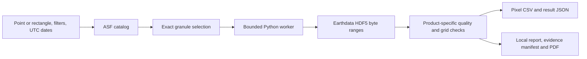

# Research workflow

1. In Explore, enter decimal latitude and longitude, choose a suggested place, or draw a rectangle. Apply dates, NISAR product, orbit direction, track and record limit.
2. Open Readiness or Records. Use the suggested source selection or choose exact granules. Suggestions screen catalog identifiers and acquisition geometry. The processor makes the final decision from the science grids.
3. Run the analysis and check the accepted pixel count, units, and interpretation notes. Download the georeferenced CSV for valid pixels, or the JSON for the complete sampled grid and source links.
4. Open the saved report in Reports. Print it to PDF or export the evidence manifest. A processed report records the exact query, granules, selected location, projected grid, quality rule, measurements and rendered previews.

| Research question | Measurement available today | Interpretation limit |
| --- | --- | --- |
| Where did radar response change near a wetland or forest? | GCOV backscatter on one date or matched later-minus-earlier differences in dB | A backscatter change does not establish flooding, land cover change, or area. |
| How did the published soil moisture estimate change? | SME2 volumetric retrievals that pass the source recommendation bit, with matched differences when two grids align | Provisional products require independent validation, including in situ measurements for absolute values. |
| Is a radar interferogram suitable for further analysis? | GUNW coherence screened by a researcher-selected threshold, finite phase and valid connected components | A displacement study must apply a reference and assess atmospheric, ionospheric and other phase terms. |
| What offsets did the source tracking product return? | GOFF layer 1 along-track offsets and median slant-range offset, screened by normalized correlation peak | Offsets are exploratory. Deriving velocity or confirming glacier motion requires additional validation. |

## Data and compute boundaries

Date inputs are inclusive UTC days. Catalog queries can return up to 250 records. Empty results can reflect archive coverage or restrictive filters. A successful record lookup does not guarantee useful pixels at the selected point.

The synchronous worker reads one 128 × 128 window per acquisition from the official source files. For a drawn rectangle, the window starts around the rectangle center and pixel centers outside the rectangle are excluded. A wide rectangle still requires tiling to compute complete area statistics. There is no interpolation between mismatched paired grids.

The browse image is a separately supplied preview. Analysis reads calibrated or provisional measurement datasets from HDF5 independently of browse availability. A missing browse asset does not block science-file access. Report storage is browser-local. Download the report or manifest to keep a portable copy.

With the local server running and an Earthdata credential configured, `node tests/gcov-live.mjs` checks the reference backscatter pair. Run `node tests/research-live.mjs http://127.0.0.1:5173 SME2` for the published soil moisture pair, or substitute `GUNW` or `GOFF` for the corresponding source assessment.

## Architecture for full-area processing

The deployed worker runs synchronous window requests. Complete area coverage needs an asynchronous service with the following responsibilities.

| Component | Responsibility |
| --- | --- |
| Job API | Validate and freeze the AOI, UTC interval, product, selected granules, algorithm parameters and method version. Return a job ID and the input manifest immediately. |
| Durable queue and worker | Record queued, running, succeeded and failed states. Split the AOI into projected tiles, retry transient archive failures by tile, and retain checkpoints so a worker restart can resume. |
| Raster and report storage | Write versioned measurement and quality rasters together with the source IDs, coverage, grid, masks and processing version. Generate the report from the same persisted outputs. |
| Validation | Test against reference sites with known observations or ground truth. Publish measured coverage, calibration and uncertainty limitations. Withhold area totals when source coverage is incomplete. |

For example, a wetland-area report needs a validated water classification, comparable observations, valid-data intersection, and area computed on an appropriate projected grid. Median radar response in a sample cannot answer how many hectares flooded. Two research outputs should stay distinct: a map of the measured signal and a validated estimate of the environmental change.

See the ASF product guides for [GCOV](https://nisar-docs.asf.alaska.edu/gcov/), [SME2](https://nisar-docs.asf.alaska.edu/sme2/), [GUNW](https://nisar-docs.asf.alaska.edu/gunw/) and [GOFF](https://nisar-docs.asf.alaska.edu/goff/).
