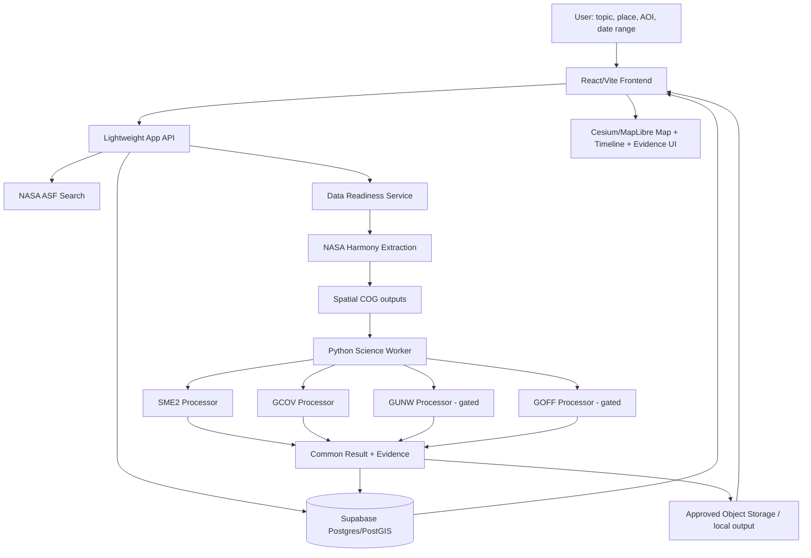

# System Architecture — Earth Signal

## 1. Architectural objective

Retain the working Zenith React/Cesium/ASF discovery foundation while introducing a separate, testable Python scientific-processing service. Heavy raster processing must not run inside the browser or a short-lived Vercel route.

## 2. Logical architecture

## 3. Deployment boundary

### Frontend / lightweight application API

- Keep the existing Vite application initially to reduce migration risk.
- Vercel can serve the built frontend and lightweight metadata endpoints if the plan terms/limits fit.
- Use server-side routes only for small, bounded requests: ASF search proxy, job status, metadata, watchlist CRUD.
- Never proxy full science HDF5 through an unbounded serverless function.

### Science worker

- Python service using FastAPI for orchestration and Rasterio/GDAL/xarray/NumPy for processing.
- During development: run locally on the developer's CPU.
- During a demo: use local worker plus verified precomputed result artifacts if public deployment cannot host the worker reliably.
- Production hosting is a separate decision; no always-on free compute is assumed.
- Worker should accept job IDs and metadata, not arbitrary filesystem paths or arbitrary remote URLs.

### Storage

- NASA remains source of truth for original science products.
- Store small metadata records, evidence records, derived layers and previews only.
- Use temporary storage for intermediate rasters and clean it after retention period.
- Supabase Storage is optional and quota-bound; store COGs only when file size and egress fit the approved plan.
- Do not create a mirror of the NASA archive.

## 4. Backend responsibilities

### Discovery API
- Accept topic, AOI, dates and optional product filters.
- Validate/normalize search parameters.
- Query ASF server-side.
- Return normalized metadata and source URLs.
- Cache only where useful and label cache freshness.

### Readiness engine
- Group observations by product and acquisition geometry.
- Check spatial overlap and product-specific compatibility.
- Check maturity, data version, dates, polarization/frequency where applicable, QA/valid masks and required variables.
- Return `ready`, `limited` or `not_ready`, with reason codes and evidence.

### Extraction adapter
- Submit a documented Harmony request for selected variables and AOI.
- Track async job status if required by the current service.
- Validate output format, dimensions, CRS, geotransform, bands, nodata and units.
- Do not invent Harmony service names or variable paths; inspect current NISAR service documentation and sample metadata first.

### Science worker
- Execute a product-specific processor.
- Use windowed/chunked operations; cap pixels, dimensions, concurrency and output sizes.
- Preserve masks and data types.
- Generate result rasters, summaries, diagnostics and evidence.
- Return a structured terminal status.

### Evidence service
- Store exact source granules and URLs/DOIs.
- Store input variable identifiers, units, transformations and processing parameters.
- Store software/environment version, timestamp and QA references.
- Store warnings, no-data fraction and known interpretation limitations.

## 5. Frontend responsibilities

- Discovery home and topic lenses.
- AOI selection and date range.
- Readiness results.
- Investigation workspace with map, timeline and comparison.
- Evidence/methodology drawer.
- Watchlist and export.
- Explicit distinction between live observations, cached metadata, precomputed analyses and simulations.

## 6. Existing Zenith components to reuse conditionally

- `GlobeViewer.jsx`: map/globe foundations; audit imagery/terrain licensing and tokens.
- `CatalogTimeline.jsx`: temporal selection UI; redesign to group observations by product and compatibility.
- `CatalogFilters.jsx`: adapt for topic and data-readiness filters.
- `RecordDetails.jsx`: reuse metadata/QA inspector sections.
- `catalog.js`: reuse WKT normalization and metadata normalization after tests.
- `api/asf-search.js`: reuse concept but harden input validation, errors, caching and DB persistence.
- `api/earthdata-asset.js`: replace/extend cautiously; no complete-file proxy for large science assets.
- `api/watchpoints.js`: replace public-write policies with user ownership and checked DB operations.

## 7. Replace or quarantine

- `sarChangeEngine.js`: quarantine as legacy/demo until a calibrated-data science engine replaces it. Do not use its output as scientific evidence.
- Procedural SAR preview: keep only if clearly labelled `Simulation` and never mixes into real result objects.
- Static SME2 point data: retain as a test fixture/reference only after reconciling its stats and provenance against the source HDF5.

## 8. API design guidelines

- Version app APIs under `/api/v1` where practical.
- Validate all input with typed schemas.
- Use structured error codes, not raw stack traces.
- Add request IDs and correlation IDs across app, Harmony and worker jobs.
- Make job submission idempotent.
- Limit search result count and AOI size.
- Add pagination and timeouts.
- Record cache source and fetched-at timestamps.

## 9. Observability

- Structured logs: request_id, investigation_id, job_id, provider, stage, elapsed_ms, status, error_code.
- Never log tokens, credentials, raw auth headers or private user data.
- Track: ASF search latency/error rates, Harmony extraction status, worker duration, raster size, peak RAM, valid pixel fraction, output bytes and storage use.
- Add a diagnostics page for the demo showing integration status without exposing secrets.

## 10. Architectural decisions to record

Codex must create/update `DECISIONS_LOG.md` for choices involving framework migration, storage provider, authentication, basemap/terrain, worker hosting, job queue, data retention and external APIs.
